  

  <a href="https://in.linkedin.com/in/hardikparave">LinkedIn</a>

  

  

  

<!-- SNAKE: uncomment this block after the first successful "Refresh profile"
     workflow run. The images live on the `output` branch, which does not exist
     until that run creates it, so showing them earlier gives a broken image.

  <picture>
    <source media="(prefers-color-scheme: dark)" srcset="https://raw.githubusercontent.com/Hardik29-not/Hardik29-not/output/github-snake-dark.svg" />
    <source media="(prefers-color-scheme: light)" srcset="https://raw.githubusercontent.com/Hardik29-not/Hardik29-not/output/github-snake.svg" />
    
  </picture>

-->

  Profile design by <a href="https://github.com/UllekhPatel">@UllekhPatel</a>

